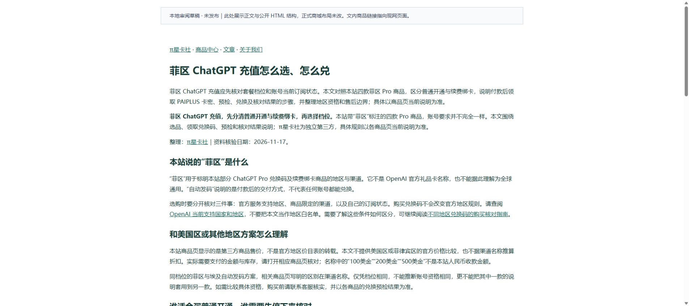

# 菲区 ChatGPT 博客草稿审阅

本目录仅为第一阶段审阅稿，未发布。标题为「菲区 ChatGPT 充值怎么选、怎么兑」，拟用地址为 `/blog/chatgpt-ph-recharge-guide`。

分支：`codex/blog-ph-chatgpt-20261117`。基线与完成本地验证时核对的 `origin/main` 均为 `7276bac1c0f350dd605062e1ba0dd15ece7786a8`。店主随后授权将草稿和验证记录提交推送至该独立分支供 Grok 审核，明确不合并、不上线；实际提交以本分支 Git 历史为准。

## 直接阅读与预览

- [完整 Markdown 正文](chatgpt-ph-recharge-guide.md)：适合发给 Grok 审阅；包含标题、摘要、全文和可点击的完整站内网址。
- [可直接用浏览器打开的预览](preview.html)：无需数据库、账号或构建，也可双击文件打开。
- [正文 HTML](chatgpt-ph-recharge-guide.html)：拟存入文章正文的内容，不包含本地审阅提示。
- [草稿清单](catalog.json)：标题、摘要、slug、中文正文文件、未发布状态及可选商品关联候选。
- [事实出处](sources.json)、[内容与结构验证](validation.json)、[站内链接检查](link-checks.json)。

本地验收时使用的临时预览为 <http://127.0.0.1:5197/preview.html>，仅绑定本机，计划于 2026-11-17 17:04（北京时间）自动停止。异地审阅请直接阅读本分支的 Markdown，或下载本目录后用浏览器打开 `preview.html`；本机地址不是已上线网址。

预览复用当前项目公开正文渲染器及其原有正文样式，去掉会接管页面的商城启动脚本，并加上本地审阅提示。它用于核对文章内容、链接和结构化数据，不是对商城整页交互外观的发布预览；本轮没有修改商城样式或布局。正文内链接会打开现网已有商品或文章。

## 内容与事实边界

正文为 **2,011 个可见汉字**，包含标点、英文等的非空白字符共 2,474 个；摘要为 89 个汉字。包含 7 个 H2 小节、四款商品的对照表、6 步兑换说明与 5 条 FAQ。

四款菲区 Pro 均有独立链接，明确区分普通开通与续费绑卡；另链接 GPT 充值分类页、Plus 兑换说明、地区核对、续费、故障排查、交付售后和关于页。12 个不同的站内链接均实测 HTTP 200、无跳转且 canonical 与链接一致。

Plus 仅单独说明，不归为菲区商品。按店主明确要求省略账号售卖相关关键词及 FAQ。没有填写官方美区/菲区价格、折扣、固定人民币售价或库存承诺；没有扩展商品未说明的资格、退款规则或开通保证。现有页面没有依据的比较已省略，正文没有事实占位项。

资料核验日为 2026-11-17。正文事实来自现网公开商品、文章、站点身份页及文内链接的 OpenAI 帮助中心；公开响应指纹见 `sources.json`。未查询客户订单、卡密或任何私有交易数据。

## 已完成的本地验证

- 使用当前仓库真实 `publicpage` 渲染器与内存草稿数据生成预览，没有启动业务后端或写入 SQLite。
- 自动生成一份 `BlogPosting`、一份 `BreadcrumbList` 和一份 `FAQPage`；5 条结构化问答与可见正文逐条一致，没有叠加 Product 或重复 Article。
- HTML 与 Markdown 的全部可见正文、所有链接逐项一致；预览中的正文与原始 HTML 一致。
- 标题、摘要、规范 URL、默认 1200×630 分享图符合草稿清单。未添加新媒体。
- 浏览器实际打开预览，标题、7 个小节、4 行商品对照表和全文正常；所测桌面视口无横向溢出，未捕获控制台警告或错误。
- 预览有 `noindex, follow`，正式发布日期留空；这是未发布草稿的状态，不能直接把预览文件作为生产页面部署。
- 只读核对时，拟用线上 HTML 地址返回 HTTP 404。对应公开 API 的 HTTP 状态为 200，JSON 业务状态为 404、表示文章不存在，不能误报为 API HTTP 404。公开不存在也不能排除后台同名草稿，正式发布前仍要核对 slug 唯一性。

首轮本地 Go 渲染在沙箱中无输出超时，清理命令也受到权限限制；随后核实任务进程状态，并在允许的本机环境以编译进度诊断重新执行，6.52 秒通过。原失败与成功日志均保留在项目 `work/codex-logs/`，未把首次失败计为通过。网页抓取曾受本机网络沙箱限制，成功读取后又发现现有 API 使用 HTTP 200 携带业务 404；最终验证按实际协议核对通过。

这次仅生成文章审阅资料，没有改动支付、结账、订单、售价、卡密、采购、后台鉴权、Nginx、既有文章或 `gpt-recharge.json`，没有部署、生产写入或 Google 索引申请。

## 审阅项及后续范围

1. **【发布前须店主确认】** 标题、摘要与完整正文是否通过审核；收到明确发布授权前保持草稿。
2. **【发布前须店主确认】** 是否在发布时额外关联四款商品。候选为 id 45 / 31 / 33 / 32，已与公开 slug 对应核对，发布前需重核；当前只写正文链接，未建立数据库关联。
3. **【发布前须店主确认】** 是否给地区核对文或充值方式文补一条回链；当前没有改任何旧文章。

分享图沿用站点现有默认图，不新增封面。不补充无公开依据的官方价格比较或额外地区资格。

发布获批后才准备已审阅的内容事务、真实发布日期、`blogSlugs` 与作者信息，以及获批的商品关联或回链；随后核对正式正文、结构化数据和 sitemap，再按授权申请索引。`catalog.json` 是本次草稿清单，不是可直接交给旧内容迁移脚本执行的生产载荷。现在到第一阶段为止，不执行发布步骤。

## 验收快照说明

`validation.json` 的 Git 状态字段保留本地验证完成时的快照，`commit_created: false`、`pushed: false` 不表示本分支当前未提交。正文、摘要、HTML/Markdown 和 FAQ 内容没有因送审归档而重写；本次补充截图并更新审阅说明和文件指纹。12 条链接的 HTTP 记录是文件中标明时间的实测结果，不是永久状态保证。原始环境日志留在本机，供公开审阅的结果、失败说明和指纹均在本目录。

