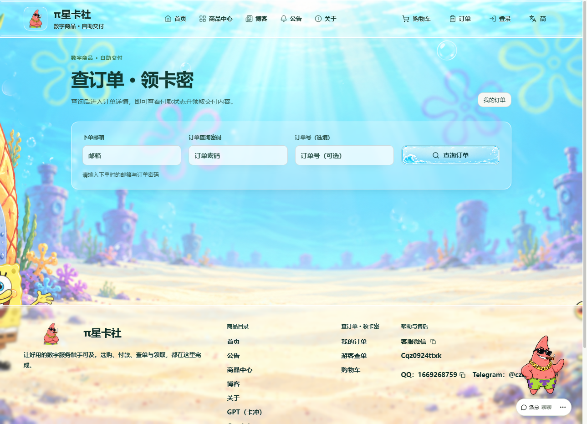

# 真实操作截图取材说明

2026-11-18 店主将取材安排交由编辑决定。本轮采用文字说明，下列清单留作今后取得真实授权素材时参考。

本轮按“第 4 项”为 S1–S5 截图素材推进；具体指代已询问，未据此发布内容或改动商城组件。

## 已完成：S0 公开查单入口

- 来源：正式站 `https://www.qzweb.cloud/guest/orders`，2026-11-17 匿名读取。
- 原始截图为 1289 × 931；全部输入为空，未点击“查询订单”，没有订单、卡密或账号记录。
- 可配的说明：“游客订单可从‘查订单 · 领卡密’入口，用下单邮箱和订单查询密码查找；订单号为选填项。”
- 这只展示公开查单表单，不证明付款、交付、预检或兑换成功。尚未发布到商品页或教程。

## S1–S5 的取材顺序

1. 仅使用有公开许可的历史案例或供应方允许公开的真实界面，不为截图新建订单、付款、采购或消耗卡密。
2. S1 拍订单交付说明中的入口位置；S2 拍真实的适用/不适用预检提示；S3 拍提交前的账号与套餐确认区；S4 拍处理状态与订阅核对区；S5 拍续费绑卡商品自身的操作指引。每张都注明真实商品及步骤，不能用普通开通图代替续费绑卡。
3. 在授权的私有环境核对原图。公开副本去掉邮箱、订单号、账号标识、卡密、密码、token/Session、支付信息以及完整私有兑换 URL；不仅隐藏 URL 参数。不得把未脱敏原图提交进仓库。
4. 保留真实提示，不添加成功状态、不改错误文案、不把个案当成普遍成功保证。附步骤说明及实际尺寸，在 390/320 宽度下核对可读性。
5. 保存到新媒体路径，保留所有已发布媒体字节。核验后再进入内容发布审阅；没有素材时保留文字说明，不发布占位图。

本地现有材料没有满足这些条件的 S1–S5。当前已完成能独立完成的公开入口取证；后续只有取得真实、可公开的记录后才能补足其余截图。
